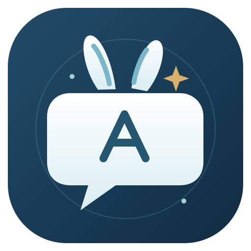
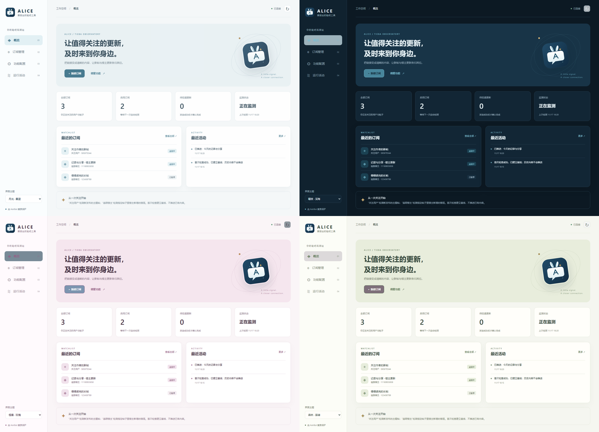

<div align="center">
  
  <h1>爱丽丝的贴吧工具</h1>
  <p>读帖子，关注新帖，追踪楼主更新。</p>
</div>

面向 AstrBot 的贴吧插件。发送帖子链接与解析关键词即可查看正文、图片、视频和楼层回复；也可以订阅用户的新主题帖，或让机器人持续提醒某个帖子的楼主更新。原生 WebUI 用于管理订阅、调整配置和查看运行状态。

## 可以做什么

| 功能 | 说明 |
| --- | --- |
| 帖子解析 | 获取主楼标题、正文、作者、吧名、原图、视频及首屏楼层回复 |
| 关注用户 | 订阅指定用户新发布的可见主题帖 |
| 追踪楼主 | 订阅指定帖子中楼主新发布的楼层，过滤其他人的回帖 |
| WebUI 管理 | 管理推送会话、关键词、订阅开关、全部配置、运行记录和媒体缓存 |
| 四套界面主题 | 月光、曜夜、樱雾、森林；支持桌面和手机布局 |
| 内容卡片与导出 | 贴吧帖子样式、多种其他皮肤、可选翻译及 ZIP 归档 |
| QQ 官方 Bot 原图图库 | 卡片单独发送，群聊与私聊的同帖原图放在一条 Markdown 图库消息中，每张图可独立点击查看 |
| 模型读帖与看图 | `alice_tieba_fetch_content` 提供正文、楼层回复及其图片，供视觉模型总结、比较和分析 |

**自动解析和订阅推送默认关闭。** 自动解析可按需开启；推送需要管理员设置。新订阅第一次成功检查只记录已有内容，不发送历史消息，后续发现新内容才推送摘要与原帖链接。

## 安装

需要 **AstrBot `>=4.25.0,<5`**。在 AstrBot「插件管理」中通过以下仓库地址安装：

```text
https://github.com/Whereis-Alice/astrbot_plugin_alice_tieba
```

安装后确认插件已启用。Cookie 可以留空，先用可公开访问的帖子测试。

Linux / Docker 环境应在 **AstrBot 实际运行的环境** 中安装中文字体，例如 Debian / Ubuntu 的 `fonts-noto-cjk`；也可在配置中指定本机字体文件。视频校验和可选压缩需要可用的 `ffmpeg` / `ffprobe`。卡片渲染失败时会回退到文本。

## 先解析一个帖子

向机器人发送：

```text
贴吧解析 https://tieba.baidu.com/p/11180655858
```

也可使用关键词 `解析贴吧`，例如 `解析贴吧 https://tieba.baidu.com/p/11180655858`。默认发送内容卡片，并按富媒体设置发送主楼图片或视频；卡片附上最多 3 条首屏楼层回复。在 QQ 官方 Bot 群聊与私聊中，先发送卡片，再用原生 Markdown 图库发送该帖原图；每张图都能独立点击查看，视频单独发送。

希望直接发送链接就解析时，开启「触发设置 → 自动解析链接」。如果同时使用原插件，请避免两边都自动解析，以免同一链接收到两份回复。

支持标准 `/p/帖号`、移动端 `kz` / `tid`、旧 WAP 入口和移动视频分享链接。引用消息解析需要额外开启「回复触发解析」，并在引用时附上配置中的触发关键词。

## 贴吧卡片与图片发送

默认使用 **贴吧帖子** 卡片风格和浅色配色，接近贴吧 App 帖子阅读页的样式：白底蓝色、吧名与作者信息、标题正文、大图和楼层回复。可在「消息输出 → 卡片渲染」中改用其他风格或深色配色。旧版「贴吧帖子」选项误用的 B 站样式会在升级后改用贴吧专属样式。

**QQ 官方 Bot 群聊与私聊默认先单独发送卡片，再将该帖原图放在第二条原生 Markdown 图库消息中。** 每张原图独立展示，可分别点击查看；不同帖子各自发送图库，视频仍单独发送。群聊与私聊可直接使用自定义 Markdown，无需另行申请模板；本插件在 QQ 频道中暂时逐图发送。

需要逐条接收图片时，在消息输出配置中关闭 QQ 官方 Bot 原图图库。图库发送失败时会回退为逐图发送。QQ 官方 Bot 不支持 OneBot 式合并转发，选择聚合模式也会自动按普通消息逐帖发送。OneBot 和其他平台沿用各自原有的发送方式。更多设置见 [卡片样式与平台发送说明](docs/cards.md)。

## 开始订阅推送

1. 在插件配置的「订阅与更新推送」中开启「启用订阅推送」。
2. 在希望接收推送的群聊或私聊中，由管理员发送关注或追踪命令。
3. 在 WebUI 查看首次检查结果。基线记录成功后，等待目标发布新内容。

```text
贴吧 关注 https://tieba.baidu.com/p/11180655858
贴吧 追踪 https://tieba.baidu.com/p/11180655858
贴吧 订阅
```

关注用户时，直接填写 **该用户发布的任意可访问帖子链接**，插件会识别楼主并关注其新主题帖。已知 UID 时也可以发送 `贴吧 关注 595970344`。示例中的链接与数字请替换为实际目标；贴吧 UID 是数字账户标识，不是昵称或 QQ 号，当前版本不通过昵称搜索用户。

| 命令 | 用途 |
| --- | --- |
| `贴吧` 或 `贴吧 帮助` | 查看帮助 |
| `贴吧 会话` | 获取当前推送会话标识，供 WebUI 使用 |
| `贴吧 订阅` | 查看当前会话的订阅及其 ID |
| `贴吧 关注 <UID或该用户的帖子链接>` | 识别目标用户，关注其新主题帖 |
| `贴吧 追踪 <帖子链接或帖号>` | 追踪楼主新楼层 |
| `贴吧 暂停 <订阅ID>` | 暂停一个订阅 |
| `贴吧 恢复 <订阅ID>` | 恢复一个订阅 |
| `贴吧 取消 <订阅ID>` | 删除一个订阅 |
| `贴吧 检查 [订阅ID]` | 手动检查一个订阅；省略 ID 时检查当前会话 |

命令遵循 AstrBot 的指令前缀设置；例如配置了 `/` 时，请使用 `/贴吧 订阅`。聊天订阅操作默认仅 AstrBot 管理员或本插件配置的管理员可用，范围限于当前会话。WebUI 使用 AstrBot 登录权限，可管理全部会话。

首次基线、暂停恢复、关键词筛选、发送重试和追踪范围见 [订阅与推送说明](docs/subscriptions.md)。

## 让模型读帖、看图和按需发图

开启「LLM 内容抓取工具」，选择同时支持 **工具调用和图片输入** 的模型，并在 AstrBot 工具列表及当前人格中允许 `alice_tieba_fetch_content`。可以直接对机器人说：“读取这个帖子和 10 条回复，结合楼主和回复里的图片整理大家的意见：链接。”

工具默认读取主楼和已获取回复中的图片，将实际图片内容交给模型查看，并保留所属帖子、楼层和原图链接。每次默认最多提供 12 张视觉图片，按主楼与回复交错分配名额。下载失败、超时或超过数量/大小预算的图片会标注跳过，仍保留可获取的文字与链接。

用户要求发图时，模型使用 AstrBot 原生 `send_message_to_user`，因此还需要在 AstrBot 中启用并允许该工具。贴吧取数工具不会自行向聊天发送图片。原生发图可使用 AstrBot 提供的图片缓存路径或返回的原图 URL；缓存图可能经过缩小，要发送原图请使用原图 URL。完整设置与示例见 [模型读帖、看图与发图](docs/llm.md)。

## WebUI

在 AstrBot「插件管理」中找到 **爱丽丝的贴吧工具**，打开插件页面 **alice-tieba**。

页面包含概览、订阅、配置和运行活动。新增订阅时可设置推送会话、备注和关键词；配置页按功能分组，并支持搜索。填写会话标识时，先在目标聊天中发送 `贴吧 会话`，复制机器人返回的完整值。

四套主题分别为 **月光（雾蓝浅色）**、**曜夜（深海蓝暗色）**、**樱雾（玫瑰紫浅色）**、**森林（苔绿暖白）**。管理界面的主题与聊天内容卡片的皮肤独立设置。

Cookie、API Key 等秘密字段不会回显原值；留空保存会保留已有秘密，删除秘密需明确使用清空操作。完整使用方法见 [WebUI 使用说明](docs/webui.md)。

### 界面预览

以下为四套主题的示例订阅界面，左上至右下依次为月光、曜夜、樱雾、森林。



## 常用配置与默认行为

| 设置 | 默认值 / 行为 |
| --- | --- |
| 自动解析 | 关闭；使用手动关键词，或自行开启 |
| 聊天输出 | 全部发送，卡片模式为「仅卡片」，主楼媒体按富媒体设置投递 |
| 卡片风格 | 贴吧帖子，可改用其他皮肤 |
| 卡片深浅配色 | 浅色，可改为深色 |
| QQ 官方 Bot 原图图库 | 开启；群聊与私聊先发卡片，再用 Markdown 图库展示同帖原图；视频单独发送，频道暂逐图发送 |
| 楼层回复预览 | 最多 3 条，合并到卡片；不另发回复文本 |
| 订阅推送 | 关闭，需要管理员开启 |
| 检查间隔 | 300 秒，最小 60 秒；并非即时通知 |
| 订阅总上限 | 50 个，包含全部会话 |
| 每个订阅单轮推送上限 | 10 条；积压内容后续继续处理 |
| 推送内容 | 正文摘要与原帖链接，不自动下载全部媒体 |
| 普通视频发送上限 | 48 MiB；超限默认上传原文件，跳过压缩 |
| 视频下载硬上限 | 1000 MiB |
| Cookie、代理、翻译 | Cookie 留空，代理与翻译关闭 |
| LLM 取数工具 | 开启；回复条数由模型参数决定，省略默认 5 条 |
| LLM 图片输入 | 开启；主楼与已获取回复的图片合计默认最多 12 张，单张下载上限 10 MiB |

原文件投递依赖 AstrBot 的 aiocqhttp / OneBot v11 接入和协议端的文件上传能力。群聊还需具备群文件上传权限。如果协议端与 AstrBot 分开部署，协议端必须能读取下载文件路径；仅设置媒体 HTTP 中转不会解决群文件的本地路径问题。

ZIP 归档默认关闭。可在「归档命令」中设置 `贴吧打包` 等自定义关键词，随后引用含帖子链接的消息并单独发送该关键词。正文和回复翻译也默认关闭，可使用 AstrBot 已配置的模型或自定义接口。

默认缓存清理关键词为 `清理贴吧缓存`，仅管理员可用；也可以通过 WebUI 清理媒体缓存。

## 使用范围与常见问题

- **为什么刚关注没有推送？** 第一次成功检查只建立基线。请确认全局推送与该订阅都已启用，并在运行活动中查看结果。
- **为什么新内容有延迟？** 检查间隔、订阅数量、平台访问限制和发送重试都会影响时间。默认每 5 分钟检查，实际完成一轮可能更久。
- **楼主更新包含什么？** 仅楼主新发布的普通楼层；旧楼编辑、楼中楼、他人回帖不属于追踪范围。
- **为什么缺少部分帖子？** 只处理贴吧接口可返回的内容。用户隐藏动态、删帖、权限限制、风控和签名媒体失效都会影响结果；配置 Cookie 不保证能访问受限内容。
- **可以与原插件共存吗？** 插件名、Python 包、工具名、管理路由及默认缓存已独立。两边同时自动解析，或配置了相同的手动关键词，可能各回复一次。请关闭其中一边的自动解析，并在两边配置不同的手动关键词；本插件的默认关键词为 `贴吧解析` 和 `解析贴吧`。
- **会自动导入原插件配置吗？** 不会。新插件使用自己的配置和订阅数据，请按需重新设置；自定义缓存路径也应分别配置。

普通解析和 LLM 工具的回复是首屏预览，不提供全帖阅读或热评排行。订阅系统会按分页预算扫描更新，但也不能保证返回平台未提供的内容。

## 文档与开发

- [订阅与推送](docs/subscriptions.md)
- [WebUI 管理](docs/webui.md)
- [卡片样式与平台发送](docs/cards.md)
- [模型读帖、看图与发图](docs/llm.md)
- [LLM 工具参数](docs/llm-tool.md)
- [解析实现与来源](docs/implementation.md)
- [版本记录](CHANGELOG.md)

```bash
python -m pip install -r requirements-dev.txt
python -m pytest tests -q
python -m ruff check main.py webui.py alice_tieba_core alice_monitor tests
```

## 许可与来源

本插件基于 [astrbot_plugin_tieba_nova](https://github.com/Whereis-Alice/astrbot_plugin_tieba_nova) 改造，遵循 [GNU Affero General Public License v3.0](LICENSE)。保留原项目及第三方代码的来源和许可；新增订阅、WebUI 与图标随本仓库公开源码。详见 [NOTICE](NOTICE.md) 与 [LICENSES](LICENSES)。
