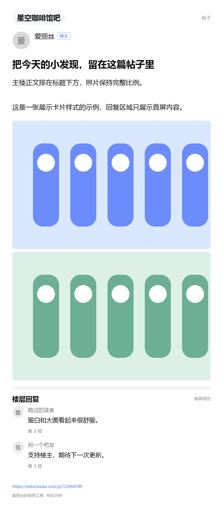

# 卡片样式与平台发送

卡片决定帖子内容如何排版，平台发送设置决定卡片、图片和视频如何出现在聊天里。两者可分别设置。

## 使用贴吧帖子样式

本插件默认使用 **贴吧帖子** 风格和浅色配色。需要调整时，打开 WebUI 的「配置 → 消息输出 → 卡片渲染」，选择卡片风格与深浅配色后保存；页面提示需要重载时，再重载插件。

贴吧帖子样式参考贴吧 App 的帖子阅读页，默认浅色以白色背景和蓝色强调色组织内容：

- 顶部显示吧名，随后显示作者信息。
- 主楼展示标题、正文与大图。
- 末尾展示已获取的楼层回复及实际楼层号，便于区分回复来源。

回复仍是首屏预览，默认最多 3 条，不代表全帖热度排名。图片、作者或回复是否显示，继续受相应展示开关和接口可获取内容影响。

也可选择深色配色或其他卡片皮肤。WebUI 的月光、曜夜、樱雾、森林四套主题只改变管理页面，不会自动改变聊天卡片。

旧版「贴吧帖子」选项曾误用 B 站样式。升级到 v2.1.0 后，该选项会改用本次新增的贴吧专属皮肤；配置文件中的皮肤标识为 `tieba`。

以下是使用示例内容生成的卡片预览：

## QQ 官方 Bot：同帖原图图库

在 QQ 官方 Bot 的群聊与私聊中，插件默认先单独发送内容卡片，再将该帖原图放在第二条原生 Markdown 图库消息中。每张图片独立展示，可分别点击查看原图。视频单独发送；一次解析多个帖子时，不同帖子的原图各自放入对应的图库。

例如一个帖子有一张内容卡片和 3 张配图，在默认卡片设置下，会先收到卡片，再收到一条包含 3 张独立原图的图库消息。如果帖子还带视频，视频另发。

希望每张图片分别占一条消息时，在消息输出设置中关闭 **QQ 官方 Bot 原图图库**。配置字段为 `message.qqofficial_image_gallery`，默认 `true`；关闭后卡片和原图逐条发送。直接在 WebUI 修改即可，无需编辑配置文件。

若图库因素材访问或平台权限等问题发送失败，插件会回退为逐图发送。若接口超时导致发送结果无法确认，插件会提示检查会话，避免重复补发整批图片。图库只影响图片的展示方式，不改变正文、回复和媒体的解析范围。

QQ 官方已在 2026 年 4 月 23 日向所有机器人开放群聊与私聊的自定义 Markdown 能力，无需单独申请模板。QQ 频道仍需要单独开通 Markdown 权限，本插件目前在频道中逐图发送。能力范围可参阅 [QQ 官方 Markdown 文档](https://bot.q.qq.com/wiki/develop/api-v2/server-inter/message/type/markdown.html)。

## 不同平台的发送方式

| 接入方式 | 图片 | 视频 | 消息聚合 |
| --- | --- | --- | --- |
| QQ 官方 Bot 群聊 / 私聊 | 先发卡片，再发同帖原生 Markdown 图库；各原图可独立点击，关闭图库或发送失败时逐图发送 | 独立发送 | 自动使用普通消息逐帖发送，不生成 OneBot 式合并转发 |
| QQ 官方 Bot 频道 | 暂时逐图发送 | 独立发送 | 自动使用普通消息逐帖发送 |
| aiocqhttp / OneBot v11 | 保持原有卡片与媒体发送方式 | 保持原有发送方式 | 按插件聚合设置及协议端能力处理 |
| 其他平台 | 保持该平台原有发送方式 | 受平台适配器及媒体限制影响 | 受平台适配器能力影响 |

QQ 官方 Bot 的原图图库与「消息聚合」是两个设置：前者在一条 Markdown 消息中展示同帖的独立原图，后者控制合并转发。QQ 官方 Bot 无法使用 OneBot 式合并转发，因此启用聚合也会自动使用普通消息逐帖发送，每个帖子各自保留卡片与图库。

OneBot 的群文件上传还依赖协议端权限与本地媒体路径访问，详见 [README 的默认行为说明](../README.md#常用配置与默认行为)。
